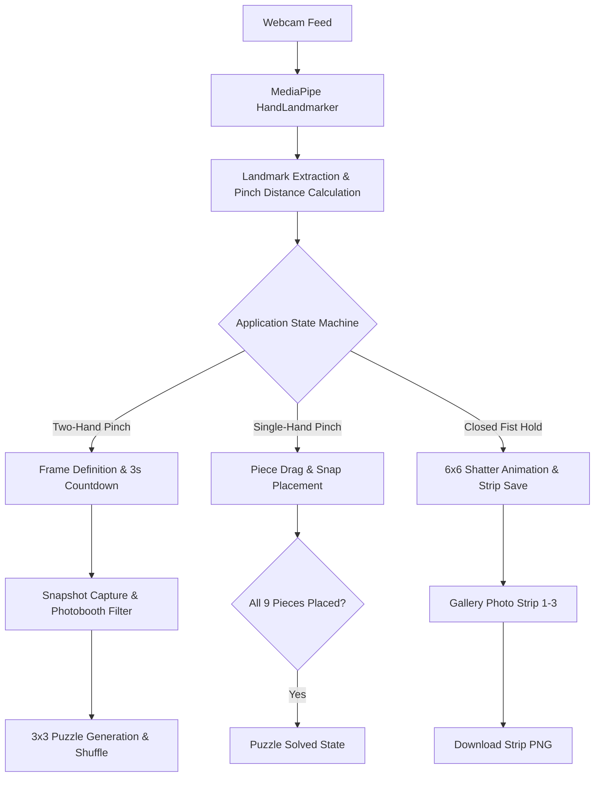

# PuzzleCam — Gesture Capture

[](LICENSE)
[](https://developer.mozilla.org/en-US/docs/Web/JavaScript)
[](https://developers.google.com/mediapipe)
[](https://developer.mozilla.org/en-US/docs/Web/API/Canvas_API)
[](https://developer.mozilla.org/en-US/docs/Web/CSS)
[](file:///d:/workspace_programming/websites/Puzzle/app.js)
[](https://www.w3.org/)

A client-side gesture-controlled photobooth and jigsaw puzzle experience running entirely in the browser. Zero installation, zero backend, and zero build toolchain required.

---

## Architecture & Technology Stack

[](https://developers.google.com/mediapipe)
[](https://developer.mozilla.org/en-US/docs/Web/API/CanvasRenderingContext2D)
[](file:///d:/workspace_programming/websites/Puzzle/app.js)



### Architecture Overview

PuzzleCam operates as a high-performance, single-threaded browser application utilizing a decoupled rendering and gesture classification loop:

1. **Computer Vision Layer**: Utilizes Google MediaPipe Tasks Vision (`@mediapipe/tasks-vision@0.10.14`) via CDN. The `HandLandmarker` model tracks 21 3D hand landmarks per detected hand in real time against a mirrored video element.
2. **Gesture Classification Engine**: Normalizes landmark Euclidean distance between the thumb tip (landmark 4) and index fingertip (landmark 8) against dynamic hand size ratios to identify pinch triggers, framing boundaries, and closed-fist gestures.
3. **Finite State Machine (FSM)**: Coordinates transitions between discrete lifecycle states:
   - `tracking`: Monitoring live webcam stream and waiting for two-hand framing gesture.
   - `countdown`: Active 3-second capture timer while holding frame bounds.
   - `puzzle`: Interactive 3x3 canvas jigsaw puzzle board with dynamic physics and snapping tolerance.
   - `solved`: Victory state showing full reconstructed image.
   - `shatter`: 6x6 fragmentation animation dispersing image tiles into particle physics.
4. **Photobooth Shader & Filter Pipeline**: Directly manipulates Canvas 2D `ImageData` pixel buffers to apply monochromatic contrast expansion, brightness shifts, and Gaussian film grain noise.
5. **Photo Strip Export Engine**: Compiles completed puzzle captures into a classic 3-frame vertical photobooth strip with date stamps and borders, exportable as PNG.

---

## Key Features

- **Hand-Framed Photo Capture**: Use both hands to form a viewfinder frame. Pinching thumb and index on both hands defines the photo crop area.
- **Countdown Timer with Visual Feedback**: Hold the framing pinch for 250ms to lock the frame; a 3-second animated countdown captures the frame automatically.
- **Vintage Photobooth Filter**: Captured photos are processed with black-and-white tonal mapping, contrast enhancement, and simulated film grain.
- **Interactive 3x3 Jigsaw Puzzle**: Photos are sliced into 9 tiles and shuffled around a dedicated board with smooth piece-pickup depth layering.
- **Gesture Drag and Snap**: Single-hand pinch grabs and drags puzzle pieces. Releasing or moving near target grid slots automatically snaps pieces into place with configurable magnetic thresholds.
- **Shatter Particle Physics**: Completing a puzzle and holding a closed fist triggers an explosive 6x6 tile fragmentation animation before archiving.
- **Triple-Frame Photobooth Strip**: Collect up to 3 puzzles in the gallery strip and download the complete composite print as an image.
- **Completely Self-Contained**: No build steps, bundlers, or servers side dependencies.

---

## Gesture Control Guide

| Gesture | State Context | Action |
|---|---|---|
| Both hands pinch (Thumb + Index) | Tracking Mode | Freeze frame boundaries and trigger 3-second capture countdown |
| Single hand pinch on tile | Puzzle Mode | Pick up, drag, and position puzzle piece across the board |
| Release pinch near slot | Puzzle Mode | Snap piece into grid slot if within magnetic snap radius |
| Closed fist (hold for 12 frames) | Solved Mode | Trigger 6x6 shatter animation and save photo to gallery strip |

---

## Directory Structure

```
Puzzle/
├── .gitignore              # Git ignore configuration
├── README.md               # Project documentation and architecture guide
├── index.html              # Application entry point and layout markup
├── app.js                  # Vision pipeline, gesture recognition, FSM, and puzzle mechanics
└── css/
    └── styles.css          # Design system, layout, responsive styling, and animations
```

### Module Breakdown

- [index.html](file:///d:/workspace_programming/websites/Puzzle/index.html): HTML5 semantic structure housing the webcam element, primary canvas viewport, HUD status indicators, progress counters, and the photobooth gallery sidebar.
- [app.js](file:///d:/workspace_programming/websites/Puzzle/app.js): Core JavaScript module implementing MediaPipe loader, landmark tracking, Euclidean pinch detection, Canvas 2D render loop, puzzle piece slicing, state machine, and strip compilation.
- [css/styles.css](file:///d:/workspace_programming/websites/Puzzle/css/styles.css): CSS styling adhering to modern dark-theme aesthetic, flexible layout, custom scrollbars, loading overlays, and status indicators.

---

## System Requirements

- **Supported Browsers**: Google Chrome (recommended), Microsoft Edge (recommended), Mozilla Firefox.
- **Hardware**: Standard webcam or external USB camera.
- **Internet Connection**: Required once during initial boot to download the MediaPipe HandLandmarker vision model (~10 MB) from CDN.
- **Hosting Environment**: Must be served over HTTP/HTTPS due to WebRTC and ES Module security constraints (`file://` protocol is blocked by browsers).

---

## Installation & Local Development

### 1. Clone the Repository

```bash
git clone https://github.com/thulanesigasa/Puzzle.git
cd Puzzle
```

### 2. Start a Local HTTP Server

Serve the directory with any local development server:

#### Option A: Python Built-In Server

```bash
python -m http.server 5500
```

#### Option B: Node.js (npx serve)

```bash
npx serve -l 5500 .
```

#### Option C: VS Code Live Server

Install the [Live Server](https://marketplace.visualstudio.com/items?itemName=ritwickdey.LiveServer) extension in VS Code and click **Go Live**.

### 3. Open in Browser

Navigate to:

```
http://localhost:5500
```

Grant webcam permissions when prompted by your browser.

---

## Technical Stack & Dependencies

- **[MediaPipe Tasks Vision](https://developers.google.com/mediapipe)** `v0.10.14`: Real-time on-device machine learning hand landmark tracking.
- **HTML5 Canvas 2D API**: High-frequency graphics rendering, puzzle piece manipulation, and pixel processing.
- **JavaScript (ES6+ Modules)**: Pure modern vanilla JavaScript without external runtime frameworks.
- **CSS Custom Properties**: Fluid typography, responsive layout, and dark-mode styling tokens.

All third-party libraries load directly from verified CDNs (`cdn.jsdelivr.net` and `storage.googleapis.com`).

---

## Troubleshooting

### Camera Fails to Start

- Ensure no other application (Zoom, Microsoft Teams, Discord, OBS Studio) has exclusive access to the camera.
- Check browser privacy settings to confirm camera permissions are granted for `localhost`.

### Vision Model Does Not Load

- Confirm an active internet connection.
- Verify access to `cdn.jsdelivr.net` and `storage.googleapis.com` (ensure they are not blocked by firewall or ad-block rules).

### Black Screen or Canvas Not Initializing

- Ensure the application is accessed through an HTTP server (e.g., `http://localhost:5500`) rather than directly opening `index.html` via `file://`.

### Gesture Recognition Inaccuracy

- Ensure adequate, even lighting on your hands against a contrasting background.
- Keep hands fully visible within the camera field of view.
- When pinching, bring the thumb tip and index fingertip within close proximity until the tracking marker turns yellow.

---

## Browser Compatibility

| Browser | Support Level | Notes |
|---|---|---|
| Google Chrome | Full | Recommended for optimal WebRTC and WebAssembly performance |
| Microsoft Edge | Full | Chromium-based, full feature parity |
| Mozilla Firefox | Full | Supported |
| Apple Safari | Partial | Camera permission prompts may require manual allowance |
| Mobile Browsers | Experimental | Desktop environment recommended for two-hand framing gestures |

---

## License

This project is licensed under the [MIT License](LICENSE) — free to use, modify, and distribute.
